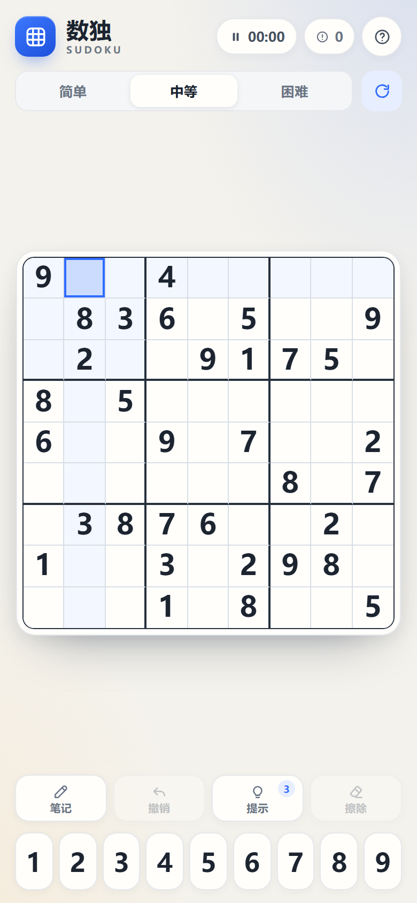

# 数独 · 静心一局

一个用原生 JavaScript 写的单文件数独小游戏。没有依赖、没有网络请求，打开就能玩，并针对 iPhone Safari 做了触控、安全区域和横竖屏适配。



## 快速开始

**在电脑上：** 直接双击 `index.html`。

**在 iPhone 上：** iOS 对本地 HTML 文件的限制较多，推荐用 HTTP 打开：

1. 把 `index.html` 上传到任意静态托管（GitHub Pages、Netlify、Vercel 等），用 Safari 访问。
2. 或让 iPhone 和电脑连同一个 Wi-Fi，在项目目录运行：

   ```powershell
   python -m http.server 8000
   ```

   然后在 iPhone Safari 打开 `http://电脑的局域网IP:8000`（Windows 可用 `ipconfig` 查看 IPv4 地址，必要时允许防火墙）。

打开后点 Safari 的「分享」→「添加到主屏幕」，就能以接近原生 App 的全屏方式游玩。

## 功能

- 简单 / 中等 / 困难三档难度，分别生成 41 / 33 / 27 个提示数
- 每道题都经过唯一解校验，并尽量保持中心对称
- 计时、错误计数、暂停（切到后台会自动暂停）
- 候选数「笔记」模式，填入正确数字时自动清理同行、同列、同宫的笔记
- 撤销、擦除、提示
- 完成动画、分档最佳成绩（保存在浏览器本地）
- iPhone 安全区域适配，竖屏和横屏都有布局
- 深色模式自动跟随系统

## 操作

- 点空格选中，再点底部数字填入
- 点「笔记」后，底部数字会写入候选数
- 点计时器或暂停图标可以暂停 / 继续
- 电脑上还支持方向键、数字键、`Backspace` 删除、`N` 笔记、`H` 提示、`Ctrl/Cmd + Z` 撤销

## 兼容性

- iPhone Safari / WebKit：已用 WebKit 16.4 按 390 × 844 视口验证
- 布局已在 iPhone SE（375 × 667）、iPhone 13（390 × 844）、Pro Max（430 × 932）及多组横屏尺寸下验证
- 使用 `svh` 处理 Safari 地址栏高度；不支持时回退到 `vh`
- 所有样式和脚本都在 `index.html` 中，离线也可玩

## 开发

`index.html?debug=1` 会暴露 `window.__sudoku` 测试接口；正常打开不会暴露任何调试对象。
